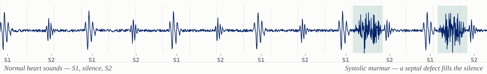

<picture>
  <source media="(prefers-color-scheme: dark)" srcset="assets/img/pcg-banner-dark.svg">
  
</picture>

# Md Hassanuzzaman

**PhD Candidate · Electrical &amp; Computer Engineering · Duke University**  
Machine learning for physiological signals — [Kamaleswaran Lab](https://www.kamaleswaran.com/), Duke University School of Medicine

[Website](https://hassan1503.github.io/Hassan1503/) · [Google Scholar](https://scholar.google.com/citations?user=q1ppZrsAAAAJ&hl=en) · [Scholars@Duke](https://scholars.duke.edu/person/Md.Hassanuzzaman) · [ResearchGate](https://www.researchgate.net/profile/Md-Hassanuzzaman) · [LinkedIn](https://www.linkedin.com/in/md-hassanuzzaman-b31218b0/)

---

I build methods that turn raw physiological recordings into reliable clinical decisions. My thesis
develops automated screening for **congenital heart disease** from heart sounds, designed to hold up
on inexpensive stethoscopes in settings where echocardiography is out of reach. Alongside it I work
on **multimodal foundation models** that learn shared representations across ECG, PPG and other
clinical signals.

I am advised by [Dr. Rishikesan Kamaleswaran](https://scholars.duke.edu/person/rishikesan.kamaleswaran)
and supported by an ECE Departmental Fellowship. Before Duke I read for an MSc in Digital Health at
the University of Bristol on a Think Big Postgraduate Scholarship.

<!-- SCHOLAR:START -->
| Citations | h-index | i10-index | Publications |
|:---------:|:-------:|:---------:|:------------:|
| **188** | **7** | **6** | **16** |

Google Scholar, 2026-10-31. Refreshed daily by a scheduled workflow in this repository.
<!-- SCHOLAR:END -->

## Research

Six threads run through my work. They share a question: what does it take for a model trained on
physiological signals to remain trustworthy outside the dataset it was fitted on?

- **Congenital heart disease screening from heart sounds** — Convolutional and attention-based models that detect structural heart defects in children directly from phonocardiograms, validated on a cohort of 751 paediatric subjects recorded at four auscultation sites.
- **Multimodal foundation models for physiological data** — Representations learned jointly across modalities rather than one signal at a time: CardioFM over ECG and PPG, Clin-JEPA over electronic health record trajectories.
- **How little signal is enough** — Deployment is bounded by recording quality and length, not by architecture. Five seconds of adequately clean audio supports reliable classification where three does not.
- **Screening where echocardiography is unavailable** — Models that survive the conditions that actually obtain in low-resource screening: a single auscultation site, ambient noise, recordings a cardiologist would call non-diagnostic.
- **Physiomarker extraction and interpretation** — Reproducible pipelines that derive cardiorespiratory physiomarkers from raw biosignals, paired with language-model interpretation of what a measurement means.
- **Fairness and transfer across sites** — Demographic bias in medical imaging models, and whether learned representations transfer across institutions without added capacity.

## Selected publications

<!-- PUBS:START -->
Work I led, work with ten or more citations, and work from this year, where the venue is citable — newest first. Citation counts come from Google Scholar.
[Full list of 16, with BibTeX, on the site &rarr;](https://hassan1503.github.io/Hassan1503/#publications)

1. **Clin-JEPA: A Multi-Phase Co-Training Framework for Joint-Embedding Predictive Pretraining on EHR Patient Trajectories**  
   Y Yang, M Arora, R Zhang, B Abed, J Kim, T Choudhary et al.  
   *arXiv:2605.10840*, 2026 · [paper](https://arxiv.org/abs/2605.10840) · 3 citations
2. **CardioFM: A multimodal foundation model for joint ECG and PPG representation learning**  
   **M Hassanuzzaman**, T Choudhary, A Gent, MV Podgoreanu, SM Agarwal et al.  
   *Research Square (preprint rs-9652631)*, 2026 · 3 citations
3. **MMMuLNet: Multimodal Mutual Deep learning Framework for the Pediatric Congenital Heart Disease Detection**  
   A Jabbar, **M Hassanuzzaman**, KI Ahmad, R Mostafa, AH Khandoker et al.  
   *IEEE Journal of Biomedical and Health Informatics*, 2026
4. **Classification of short-segment pediatric heart sounds based on a transformer-based convolutional neural network**  
   **M Hassanuzzaman**, SK Ghosh, MNA Hasan, MA Al Mamun, KI Ahmed et al.  
   *IEEE Access*, vol. 13, pp. 93852–93868, 2025 · 23 citations
5. **Automated detection of pediatric congenital heart disease from phonocardiograms using deep and handcrafted feature fusion**  
   A Jabbar, E Grooby, YY Poh, KI Ahmad, **M Hassanuzzaman**, R Mostafa et al.  
   *Computers in Biology and Medicine*, vol. 197, 110993, 2025 · [paper](https://dukespace.lib.duke.edu/server/api/core/bitstreams/d5afd6a1-4f6f-4ca8-ae68-c888842b0faf/content) · 14 citations
6. **Skin cancer machine learning model tone bias**  
   J Pope, **M Hassanuzzaman**, W Chapman, H Day, M Sherpa, O Emara et al.  
   *arXiv:2410.06385*, 2024 · [paper](https://arxiv.org/abs/2410.06385) · 13 citations
7. **Recognition of pediatric congenital heart diseases by using phonocardiogram signals and transformer-based neural networks**  
   **M Hassanuzzaman**, NA Hasan, MA Al Mamun, M Alkhodari, KI Ahmed et al.  
   *45th Annual International Conference of the IEEE Engineering in Medicine & Biology Society (EMBC)*, 2023 · 19 citations
8. **A deep learning model for recognizing pediatric congenital heart diseases using phonocardiogram signals**  
   **M Hassanuzzaman**, NA Hasan, MA Al Mamun, KI Ahmed, AH Khandoker et al.  
   *Computing in Cardiology (CinC)*, vol. 50, pp. 1–4, 2023 · 3 citations
9. **Blood glucose level regression for smartphone ppg signals using machine learning**  
   TT Islam, MS Ahmed, **M Hassanuzzaman**, SA Bin Amir, T Rahman  
   *Applied Sciences*, vol. 11, no. 2, 618, 2021 · 90 citations
10. **An efficient surface map creation and tracking using smartphone sensors and crowdsourcing**  
    MR Ali Sarker, **M Hassanuzzaman**, P Biswas, SH Dadon, T Imam et al.  
    *Sensors*, vol. 21, no. 21, 6969, 2021 · 11 citations
11. **End to end solution for continuous monitoring and real-time analysis of vital signs from ECG signal**  
    **M Hassanuzzaman**, P Biswas, T Rahman  
    *IEEE R10 Humanitarian Technology Conference (R10-HTC)*, pp. 55–60, 2019 · 8 citations
<!-- PUBS:END -->

## Education

| Years | Degree | Institution |
|:--|:--|:--|
| 2025 — present | PhD, Electrical &amp; Computer Engineering | Duke University |
| 2021 — 2022 | MSc, Digital Health | University of Bristol |

## Recognition

- **ECE Departmental Fellowship**, Duke University — 2025
- **Think Big Postgraduate Scholarship**, University of Bristol — 2021

## Contact

I am glad to hear from researchers working on physiological signals, clinical foundation models, or
screening in low-resource settings — and from students considering this area. The quickest route is
[Scholars@Duke](https://scholars.duke.edu/person/Md.Hassanuzzaman) or
[LinkedIn](https://www.linkedin.com/in/md-hassanuzzaman-b31218b0/).

This profile and the [accompanying site](https://hassan1503.github.io/Hassan1503/) are built
from this repository. The figure above is a synthesised phonocardiogram; the code that draws it is in
<code>scripts/build_banner.py</code>.
